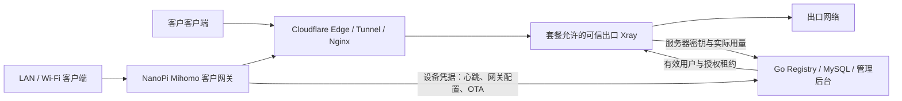

# Hive — ARM 边缘节点与订阅服务平台

Hive 面向 Rockchip ARM 开发板，提供节点初始化、代理出口、局域网网关、套餐订阅和客户门户。管理端使用 **Go + MySQL**，前端使用 **Next.js / React / TypeScript**，设备端使用 Bash 和 systemd。

业务关系为：**可信出口 → 线路 → 套餐 → 客户订阅**。运营方控制的服务器通过 Xray 提供代理出口；客户 NanoPi 通过 Mihomo 为有线 LAN 和 Wi-Fi 客户端提供网关服务。设备默认没有出口计费权限，需要管理员单独启用。

本轮审查的已修复项、剩余问题和验证范围见 [已知问题清单](docs/review-known-issues.md)。

## 当前功能

| 模块 | 功能 |
|---|---|
| 节点管理 | 注册、心跳、在线状态、资源指标、地区与权重、设备分配和认领 |
| 代理与网关 | VLESS + WebSocket + TLS、Clash/Mihomo 配置、透明代理、分流、上游选择、有线 LAN 和双频热点 |
| 套餐与订阅 | 套餐关联线路、客户独立订阅链接和 UUID、有效期、流量计量、同套餐续费 |
| 订单与客户门户 | 注册登录、密码找回、套餐购买、订单查询、余额抵扣、优惠码、邀请返利、设备管理 |
| 运维 | 白名单远程命令、服务控制、签名 OTA、部署回滚、数据库备份恢复 |
| 管理与支持 | 管理员角色权限、操作审计、公告、工单和邮件到期提醒 |
| 监控 | Prometheus、Grafana、Alertmanager 配置与告警规则 |

## 购买、续费和退款

订单确认支付后才开通或续费。余额或优惠抵扣后应付金额为零的订单自动确认；其他订单目前需要管理员确认收款。

- **首次购买某套餐**：创建订阅，生成独立 Token 和 Xray UUID。
- **重复购买同一套餐**：复用已有订阅，保留订阅 ID、链接、UUID 和设备绑定。未到期从原到期日增加套餐天数，已到期从付款确认日增加套餐天数。
- **续费只延长时长**：保留当前流量额度、已用流量和设备数配置，不清零、不叠加额度。流量按 UTC 自然月重置；自动超额暂停的订阅在重置后按有效期恢复，人工暂停不会被续费或月度重置解除。
- **购买不同套餐**：分别创建或续费该套餐的订阅，不自动换套餐。
- **历史已有多份同套餐订阅**：优先续费仍有效且到期最晚的一份，否则选择到期最晚的一份；不会自动合并或删除旧记录。
- **重复确认、并发付款**：事务串行处理同一客户的订单，每笔订单只增加一次时长，多笔订单的时长累加。
- **退款**：根据每笔订单实际授予的天数和付款时间重新计算到期日，保留其他未退款订单的权益；不会清除已用流量。余额抵扣和返利按原订单退回或撤销。

例如，订阅原定 6 月 30 日到期，6 月 10 日购买 30 天，新的到期日为 7 月 30 日；若 7 月 10 日才购买，则为 8 月 9 日。续费后继续使用原来的订阅链接。

后端启动时自动执行数据库迁移。migration 26 新增订单时长记录和暂停原因。缺少时长记录的历史订单、或到期日被人工修改过的订阅，退款可能需要先核对权益；系统不会猜测应扣时长或直接停掉其他订单的服务。旧版没有记录暂停原因的订阅保留原暂停状态，需要管理员核对后激活。

## 订阅授权与流量限制

客户使用 `/c/{token}` 或 `/c/{token}/vless` 获取配置。线路 `/l/{token}`、分组 `/s/{token}` 导出还需提供 `?subscription=<客户订阅Token>`，结果只包含客户套餐允许的节点，不能绕过客户额度和到期限制。管理后台可粘贴客户订阅链接后生成相应导出。

- 客户端、客户网关不参与计费上报。可信出口约每 15 秒通过独立服务器凭据向 `POST /servers/{mac}/accounting` 同步 Xray 实际累计流量并续期授权；普通设备凭据不能调用此接口或获取出口用户列表。
- 上传与下载均计入额度，多个可信出口流量汇总到同一订阅；重复同步不重复计费。客户订阅和网关配置只会包含套餐内已启用的可信出口。
- 历史计数自动回收：出口先补传旧运行周期的最后用量，再递增计费周期编号。后台启动及每小时分批清理已结束周期，只保留当前周期计数及每出口一条防重放状态；旧请求在清理后仍不会重复扣费。需配套升级出口脚本，未升级出口的旧计数暂不删除。
- 授权最长 45 秒，且不超过订阅到期时间；本地守护约每 5 秒检查一次。Registry 失联或同步失败不会无限保留访问权限。
- 到期、超额、禁用或凭证轮换后，节点关闭旧连接。当前通过重启节点 Xray 实现，因此其他在线用户会短暂重连。
- 网关失效时应用 REJECT 配置和 IPv4/IPv6 转发阻断，避免代理停止后回退到免费直连。
- Prometheus 用于监控，计费由可信出口服务器与面板同步完成。重置订阅链接同时轮换连接 UUID；节点公共 UUID 不再提供代理访问。

这是周期性计量，仍有采样与同步延迟，不是逐字节硬限额。升级已有节点必须配套更新后端、设备脚本和服务，详见 [订阅授权升级说明](docs/subscription-enforcement.md)。

## 架构



管理通道包括 Tailscale、EasyTier 和 FRP；监控通过 Prometheus / Grafana 展示。前端静态导出后由 Nginx 提供管理后台和客户门户。

## 支持的构建配置

| Profile | 硬件 | 构建命令 |
|---|---|---|
| `nanopi-zero2` | NanoPi Zero2 / RK3528，1 GB / 2 GB | `make build` |
| `nanopi-r28s` | NanoPi R28S / RK3528，1 GB | `make build-r28s` |
| `nanopi-r3s` | NanoPi R3S / RK3566 | `make build-r3s` |
| `orangepi4-lts` | Orange Pi 4 LTS / RK3399 | `make build-opi4` |
| QEMU | ARM64 UEFI 测试镜像 | `make build-qemu`、`make run-qemu` |

Wi-Fi 热点和双频能力取决于无线芯片、驱动及 AP 支持。

当前设备分为：已上线的 **Zero2 2 GB**、未上线的 **Zero2 1 GB** 和 **R28S 1 GB**。两种内存的 Zero2 共用镜像，R28S 使用独立构建配置和固件包；不能跨板型刷写。镜像按运行内存自动配置服务限额。三组设备均以 **32 GB TF 卡**为基线，**64 GB TF 卡**使用同一板型镜像；A/B 镜像首次启动将数据分区扩展到剩余空间。存量接入和新设备首刷见 [设备分组与迁移](docs/OTA.md#设备分组与迁移)。

## 设备身份与初始化

可以复用镜像，但每台设备必须配置独立的 Registry 凭证。管理员通过 `POST /admin/nodes/{mac}/credential` 签发或轮换凭证，并将返回值安装到该设备的 `/etc/hive/device-token`，权限设为 `0600`。不要把管理员 API 凭证或同一设备 Token 放入共享镜像。

**出口另有独立凭据**：在「节点详情 → 出口计费权限」启用运营方控制的服务器（或调用 `POST /admin/nodes/{mac}/server-credential`），将一次性返回的密钥安装到该服务器 `/etc/hive/server-token`，root 所有、权限 `0600`。客户名下的设备无法启用此权限；可信出口不能被客户认领或分配给客户。撤销接口为同一路径的 `DELETE`。普通设备没有该密钥时停止出口 Xray，继续使用自己的设备凭据获取网关配置、心跳和 OTA。

migration 28 将所有存量节点默认设为普通设备，必须逐台核对实际控制权后显式启用出口。旧 `GET/POST /nodes/{mac}/xray-users` 不再接受设备计费。升级需配套安装服务器密钥及新版脚本，具体步骤见 [订阅授权升级说明](docs/subscription-enforcement.md)。

| 内容 | 当前方式 |
|---|---|
| 主机名 | MAC 末 6 位生成 `hive-<mac6>` |
| SSH 主机密钥 | 随机生成并持久化；重刷且未保留密钥时会变化 |
| 设备 UUID | 随机生成并持久化，仅作为设备元数据 |
| 客户代理凭证 | 每份订阅独立生成，在节点内存中授权 |
| EasyTier IP | Registry 在 `172.20.0.0/16` 地址池中分配 |
| FRP 远程端口 | 由完整 MAC 的 MD5 映射到 `10000–59999`，仍可能碰撞 |
| Cloudflare Tunnel / DNS | 首次启动脚本通过 API 配置 |

具备设备凭证、网络和服务配置后，首次启动脚本完成节点注册、隧道和服务初始化。现有设备的身份迁移见 [代码审查修复与迁移说明](docs/review-remediation.md)。

## 快速开始

### 部署管理服务

先准备 MySQL、Registry、前端、监控和管理通道。部署配置以 [.env.example](.env.example) 为入口；该文件使用部分 `REGISTRY_*` 变量，部署脚本会映射到 Go 服务使用的 `MYSQL_*`、`ADMIN_*` 等变量，不能直接把它当作后端运行环境文件。

| 文档 | 内容 |
|---|---|
| [境外 VPS](docs/management/01-foreign-vps.md) | FRP、EasyTier 中继 |
| [Cloudflare](docs/management/03-cloudflare-tokens.md) | API Token、Account / Zone ID |
| [Tailscale](docs/management/04-tailscale-key.md) | OAuth 配置和 ACL |
| [管理 VPS](docs/management/02-china-vps.md) | Registry、MySQL、前端和监控 |
| [部署与回滚](docs/management/08-deploy-and-rollback.md) | 发布与回滚流程 |
| [数据库迁移与备份](docs/management/08-db-migration-backup.md) | 数据库操作 |

### 构建设备镜像

构建机需要 Docker 及 Armbian 所需依赖，详细要求见 [构建文档](docs/BUILD.md)。在仓库根目录执行：

```bash
make env                         # 创建 .env，不覆盖已有文件
# 编辑 .env，填写 Cloudflare、Tailscale、FRP、EasyTier 和 Registry 配置
make setup-armbian
make download-binaries
make build                       # 默认 NanoPi Zero2；其他 profile 见上表
```

将生成的镜像烧录到目标介质，为每台设备安装独立凭证后启动。可在管理后台查看注册结果，或登录设备查看服务状态。出口设备还需要加入线路并关联套餐；网关设备必须绑定有效客户订阅。

### 本地开发与验证

后端 Go 版本以 [go.mod](management/registry/go.mod) 为准，当前为 Go 1.26；前端使用 Node.js 24 和 npm。

```bash
make registry                    # 编译 Go 后端
make registry-openapi            # 从 Go 注释生成接口定义
cd management/registry-ui
npm ci
npm run gen-api
npm run typecheck
npm test
npm run build                    # 静态导出到 out/
```

Go 集成测试需要专用 MySQL 数据库，通过 `TEST_MYSQL_HOST`、`TEST_MYSQL_PORT`、`TEST_MYSQL_USER`、`TEST_MYSQL_PASSWORD`、`TEST_MYSQL_DB` 指定，然后在 `management/registry` 执行 `go test -race ./...`。测试会清空测试库中的表，不要使用业务数据库。

设备与部署脚本使用隔离环境进行回归验证，需要 Python 3、Bash、jq、OpenSSL 和常用系统工具：

```bash
python3 scripts/test-remediation.py
python3 scripts/test-subscriptions.py
```

本地环境配置见 [开发文档](docs/management/07-local-dev.md)，完整命令见 `make help`。

## OTA 更新

后台支持直接上传更新包，按 16 MiB 分片传输并自动计算 SHA256，无需另外准备下载服务器。设备使用独立凭证下载，经签名和文件校验后执行更新，后台区分安装中、完成、失败和已回滚。

```bash
make gen-ota-keys                 # 首次生成，后续版本保留同一签名密钥
make build-ota VERSION=1.0.0      # 应用包：备份、安装、健康检查，失败自动恢复
make build-ab VERSION=1.0.0       # Zero2 1 GB / 2 GB：A/B 出厂镜像 + 固件包
make build-ab-r28s VERSION=1.0.0  # R28S 1 GB：独立 A/B 出厂镜像 + 固件包
make build-ota-bootstrap VERSION=1.0.0  # 已上线设备首次接入应用 OTA
```

管理后台 OTA 存储默认保留 30 天，启动时及每小时清理过期且未被设备任务引用的包；应用包和各板型固件分别保留最近 3 个版本。废弃上传在 24 小时后清理，后台「OTA 更新 → 存储管理」支持预览和即时清理。发布记录保留，缺失包须重新上传后才能分配；保留期通过 `OTA_RETENTION_DAYS` 配置。

NanoPi 本地**不长期保存 OTA 包**，安装时从服务器下载到临时目录，完成或失败退出后删除包及解压文件；断电残留在下次 updater 启动时清理。单次下载最多 2 GiB，下载和解压前检查可用空间。应用回滚使用事务备份，固件回滚使用 A/B 旧槽，无需保留下载包。详见 [设备临时下载](docs/OTA.md#设备临时下载与包大小)。

应用更新支持失败回滚和进程中断后的开机恢复。NanoPi Zero2 / R28S A/B 路径包含双根分区、独立数据分区、冗余启动环境、备用槽写入、三次试启动和健康确认；现有单分区设备须先离线整盘刷写新镜像，之后使用系统 OTA 包升级。

**两种板型的 A/B 引导器已交叉编译验证，完整系统镜像构建和三组设备的真机验收仍待完成。** 内核完全卡死且无法自行重启时，仍需要硬件看门狗或人工重启，不能仅靠启动次数保证无人值守恢复。默认布局建议 32 GB 及以上存储。构建、上传、首刷、回切边界及验收步骤见 [OTA 与 A/B 升级说明](docs/OTA.md)。

## 功能边界

- 在线支付渠道、支付回调、外部资金退款、充值和提现尚未接通；订单状态管理不等于已完成资金结算。
- 套餐限速和设备数量已有配置字段，但尚未实现强制限速或并发设备数控制。
- 风控目前有事件表和查询接口，尚未形成自动检测流程。
- 远程操作采用白名单命令队列，设备定期拉取，非即时远程 Shell。
- 告警接收端、SMTP 和外部下载地址需要按部署环境配置。
- 历史文档可能仍包含旧版 FastAPI、确定性密钥或公共订阅的描述；当前以 Go 实现和本 README 的升级说明为准。

## 代码与文档导航

```text
management/registry/                  Go API、计费、续费、权限和数据库迁移
management/registry-ui/               管理后台与客户门户
management/nginx/                    API 转发与静态站点配置
management/prometheus/               监控配置
armbian-build/userpatches/overlay/    设备脚本、配置模板与 systemd 单元
scripts/                             镜像构建、OTA 打包和脚本回归
configs/                             构建及节点配置模板
ansible/                             批量运维
```

更多内容见 [文档索引](docs/index.md)、[节点运维](docs/NODE-OPERATIONS.md)、[故障排查](docs/TROUBLESHOOTING.md)、[身份迁移](docs/review-remediation.md) 和 [订阅授权升级](docs/subscription-enforcement.md)。
