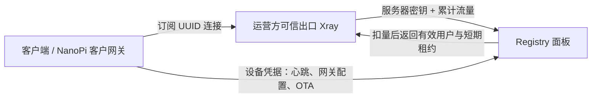

# 订阅授权与计费更新

客户订阅继续使用 `/c/{token}`，每份订阅拥有独立的 Xray UUID。重置订阅链接现在同时轮换 UUID，已导入的旧配置也会被撤销。

## 当前行为

- 客户端和客户 NanoPi 网关不提供计费用量。只有管理员明确启用、没有客户归属的可信出口服务器能通过独立的 `/etc/hive/server-token` 调用计费接口；设备凭据、客户会话、管理员会话和管理员 API 密钥都不能替代服务器凭据。
- 出口每约 15 秒通过 `POST /servers/{mac}/accounting` 同步 Xray 原始累计计数，再获得有效客户列表。上传和下载分别计费，多个出口的用量合并到同一订阅。服务端将身份校验、节点锁、计数更新配合处理，撤销或轮换密钥后，尚未提交的旧凭据请求不能继续入账。
- 上报使用 Xray systemd InvocationID 和递增的 `generation` 区分计数器生命周期。migration 25 保存最大已确认值，migration 29 增加每出口一条周期状态；事务同时提交流量、计数位置及周期推进。响应丢失、同周期乱序、重试不会重复扣量。待确认快照保存在 `/var/lib/hive/traffic-pending/`，周期文件为 `/var/lib/hive/traffic-generation.json`，重启代理前尽量捕获最后一份快照。
- Prometheus 继续用于监控，不再修改计费用量。流量统计失败时节点停止 Xray，避免无法计量的持续访问。
- 每次授权最长 45 秒，且不超过本批用户最早的订阅到期时间。有效期用 `/proc/uptime` 计算，租约只保存在 `/run`，不受墙上时钟回拨影响，也不跨重启复用。
- 独立的 `hive-subscription-guard.timer` 每约 5 秒检查租约。Registry 失联、同步进程卡住或配置无效均不会续期；到期后关闭现有连接。
- 发现撤销、超额、到期或 UUID 变化时，设备重启 Xray，关闭已建立的连接，再恢复仍有效的用户。当前是整个节点的 Xray 重启，其他在线用户会短暂重连。网关配置变化也通过重启 Mihomo 关闭旧连接。
- 客户网关失效或租约超时后，同时安装 IPv4/IPv6 FORWARD 阻断规则并写入 REJECT 配置；避免 TUN 停止时被局域网 NAT 直连绕过。续期成功且代理配置应用成功才解除阻断。
- Xray 启动前清空静态 VLESS 客户端，公共节点 UUID 不再提供代理访问。网关必须绑定有效客户订阅，无订阅的内部网关也不再提供免费出口。
- 线路和分组仍可组织节点，但导出需提供 `?subscription=<客户订阅Token>`。结果取线路/分组、客户套餐和可信出口的交集，并使用客户 UUID。后台增加客户订阅链接输入框；未输入时不能复制或预览有效导出。

### 角色与信任边界



这是 v2board/v2node 的服务器计量思路：[v2node 读取出口内核流量](https://github.com/wyx2685/v2node/blob/main/node/user.go)，通过 [ReportUserTraffic 向面板发送用量](https://github.com/wyx2685/v2node/blob/main/api/v2board/user.go)，[v2board 的 UniProxy 接口](https://github.com/wyx2685/v2board/blob/master/app/Http/Controllers/V1/Server/UniProxyController.php)核验服务器密钥并处理用户授权和流量。这里的上报方是运营方服务器，不是用户客户端。本次参考职责划分，保留 Hive 自己的累计计数、去重和租约协议；**没有实现直接接入原版 v2node 的 UniProxy 兼容层**。

每个出口使用独立密钥，普通设备凭据不能提升为出口凭据。可信出口不能被客户认领或分配给客户；撤销出口后解除这种限制，但解绑客户设备不会自动变为出口。新镜像清除服务器密钥，Xray 只在服务器密钥存在且非空时启动。不要将客户实际拥有 root 权限的机器登记为可信出口，即使它暂时没有数据库客户归属。对出口服务器 root 管理者的信任仍然存在；把推送改成拉取也无法验证被篡改的代理内核计数。

这些是周期性计量和短期授权，不是逐字节硬限额。实际超额量仍受 15 秒上报间隔、网络和节点负载影响。突然断电可能丢失最后一次采样之后的流量。正常到期可由本地短期租约截止，不必等待后台十分钟生命周期任务。

## 现有部署升级

后端和节点必须配套更新，仅更新网站不能撤销已经缓存到旧节点的公共凭证。

1. 备份数据库，并为出口节点安排短维护窗口。先停止旧节点代理，避免新旧计费同时运行。
2. 更新 Registry 和前端。Registry 自动执行待运行迁移（计费为 migration 25，续费与暂停原因为 migration 26，出口身份隔离为 migration 28，计数回收为 migration 29）。migration 28 默认将存量节点全部设为普通设备；不会因“未认领”或“已有线路”而自动信任。旧的 `GET/POST /nodes/{mac}/xray-users` 在设备认证后返回 426。migration 29 调整计数表主键，历史数据量大时应预留维护时间。
3. 核对哪些机器由运营方独占控制，在「节点详情 → 出口计费权限」启用相应服务器；也可调用管理员接口 `POST /admin/nodes/{mac}/server-credential`。密钥只返回一次，单独通过可信 SSH 安装到对应出口 `/etc/hive/server-token`，root 所有、权限 `0600`，不要写进通用镜像、客户设备或日志。普通 `/etc/hive/device-token` 仍用于该机器的注册、心跳与 OTA。密钥轮换立即废弃旧密钥；同一路径 `DELETE` 撤销出口并将其从订阅配置中移除，现有连接在剩余租约结束后停止。客户设备无需此密钥。若撤销后改作客户网关，还需在原出口停用 Xray 并删除旧 `/etc/hive/server-token`，避免本地仍按出口角色进行同步和固件健康检查。
4. 安装本次设备脚本与 systemd 单元。默认 OTA 包已包含这些文件，并自动启用/启动租约守护与同步定时器。定制 OTA 包必须包含 `hive-subscription-state`、`hive-subscription-guard`、`hive-xray-prepare`、`hive-gateway-prepare`、两个同步脚本及相应服务/定时器。没有服务器密钥的设备在同步时停止 Xray，且不发送计费请求；其 Mihomo 网关继续按绑定订阅工作。A/B 健康检查仅要求配置了服务器密钥的设备运行 Xray。
5. 手动安装时执行：

   ```sh
   systemctl daemon-reload
   systemctl enable --now hive-subscription-guard.timer
   systemctl enable --now hive-xray-sync.timer hive-clash-sync.timer
   systemctl restart hive-xray-sync.timer hive-clash-sync.timer
   systemctl start hive-xray-sync.service
   ```

6. 从 Prometheus 计费版本首次升级时，可信出口会重新启动 Xray，并写入 `/var/lib/hive/subscription-accounting-v1`。升级前运行周期的计数已经由旧 Prometheus 方案统计，不再整段补扣；切换前尚未采集的尾部流量需按业务需要核对。已使用 migration 25 累计计费的出口保持计数表、此标记和待确认快照，改用服务器凭据继续去重同步。不要删除这些数据来“清理缓存”。
7. 为需要提供网关服务的设备绑定客户订阅。向客户发送 `/c/` 链接，或在后台输入客户订阅链接后生成新的线路/分组链接；历史裸 `/l/`、`/s/` 链接不再可用。
8. 验证普通设备 Token 调用新计费接口返回 401，且不改变流量或取得用户列表；验证普通客户设备不会出现在订阅代理列表中。再验证有效订阅能连接出口；将测试订阅流量设为额度或到期后，确认现有长连接关闭；阻断出口到 Registry 的连接，确认租约到期后停止服务，再恢复网络验证恢复。

正常流量配额重置保留累计计数位置，不会把历史流量重新扣到新额度中。

## 历史计数回收

- 出口先按周期编号顺序确认全部待传快照，包括旧 Xray 停止前的最后用量；只有新的空白运行周期才通过 `GET /servers/{mac}/accounting/state` 读取后台编号并加一。编号用十进制字符串传输，避免 JavaScript 数值精度丢失；本地周期文件原子写入并刷盘后才启用用户。
- 后台只接受当前编号对应的 InvocationID，或恰好下一个编号的新 InvocationID。推进与计费同一事务提交；发生错误会一起回滚。较旧编号（包括已升级出口的无编号旧请求）返回 **410**，不给授权、不扣量，出口可删除该旧快照；同编号不同 InvocationID 或跳号返回 **409**，保留快照并停止推进，需排查重复运行的出口代理或状态恢复不一致。
- Registry 启动时及每小时清理一次，每个事务最多删除 1000 条已结束周期计数。清理与计费共用节点行锁，支持多个后台实例并发执行。当前周期计数不会因离线、额度重置或时间流逝而删除；每个出口的 `node_accounting_state` 始终保留最新编号，撤销/轮换密钥也不清除，防止旧请求在清理后重新入账。
- migration 29 将既有计数归到兼容周期 `0`。**先更新后台，再配套更新 `hive-subscription-state` 和 `hive-xray-sync`**；新脚本先补传旧快照和旧运行周期尾部用量，再切到编号 `1`。尚未切换的出口继续使用原计数去重，暂不回收其旧记录；完成切换后，下次清理自动回收历史记录。
- 切换后，该出口不能降级到不携带周期编号的同步脚本，旧请求会被拒绝。应用回滚包、A/B 备用槽也应带上支持本协议的脚本，再启用新周期；不能通过删除后台防重放状态来兼容降级。多个 Registry 实例需全部升级后再切换出口，旧后台不理解编号，不能混跑计费写入。
- 本地周期文件缺失时先重启到空白 Xray，再从后台取得下一编号，不能把旧累计量换个编号重新上报。损坏的周期文件或无法确认的快照会停止推进；丢失本地状态时，无法确认的尾部流量可能漏记，需要核对备份。不要手工清空后台周期状态或单独恢复旧数据库后直接放行新代理；恢复应保持数据库与出口待传状态一致。
- 回收删除的是去重计数，不是订阅已用流量。规模取决于当前运行周期内出现的计数器，以及两次清理之间产生的历史计数；不会为每个重启周期永久保留一条墓碑。数据库删除后的页通常由 InnoDB 复用，磁盘文件不一定立即缩小，本机制不自动执行锁表重建。

## 验证与实现依据

- Go 回归覆盖角色与凭据隔离、密钥轮换/撤销、客户认领/管理员分配与出口启用并发、订阅/网关出口筛选、事务计费、并发重试、运行周期变化、到期租约、节点禁用、跨套餐隔离、共享链接额度检查、UUID 轮换。
- `python3 scripts/test-subscriptions.py` 运行真实 Bash 同步/守护脚本，以隔离替身模拟 Registry、Xray、systemd 和防火墙，不修改测试主机网络。
- `python3 scripts/test-remediation.py` 验证默认 OTA 包携带并启用租约守护，同时保留既有安全回归。
- Xray 统计读取使用官方 [statsquery 实现](https://github.com/XTLS/Xray-core/blob/main/main/commands/all/api/stats_query.go) 的非重置查询；运行时授权只写入内存，不把客户 UUID 持久化到启动配置。
